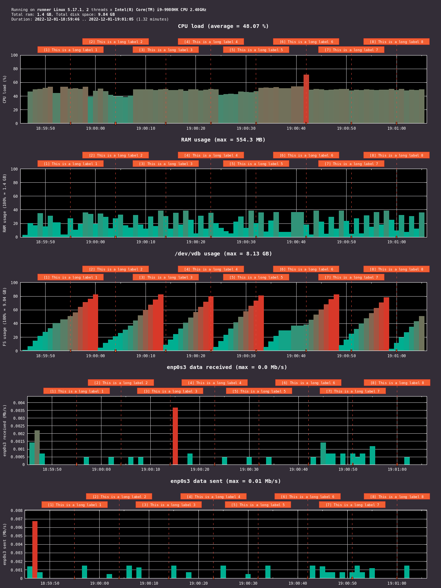

# sargraph

Copyright (c) 2019-2026 [Antmicro](https://www.antmicro.com)

This is a simple python tool that uses "sysstat" ("sar") to save information on CPU, RAM and disk usage.
The process runs in background and can be controlled with a set of sargraph sub-commands.

The tool can use "gnuplot" to optionally plot the data it collected.
Supported plot formats are PNG, SVG and ASCII, they are determined by filename extensions.

# Install requirements

The sargraph requires `gnuplot`, `sysstat` (`sar`), `python3` and `coreutils` to operate.
In Debian you can install them with:

```
# install system dependencies
apt-get update
apt-get install -qqy --no-install-recommends \
    coreutils \
    git \
    gnuplot-nox \
    python3 \
    python3-venv \
    python3-pip \
    sysstat

# install Python dependencies
python3 -m venv .env
source .env/bin/activate
pip3 install -r requirements.txt
ln -s $(realpath sargraph.py) .env/bin/sargraph
```

For rendering HTML plots, you additionally have to install:

```
pip3 install git+https://github.com/antmicro/servis#egg=servis[bokeh]
```

# Example graph




# Usage
All sargraph commands use the following pattern:

```
$ sargraph [session_name] [command] [args...]
```

Let's create a sample disk on which we will run stress tests:

```
dd if=/dev/zero of=sample_disk.ext4 bs=1M count=130
mkfs.ext4 sample_disk.ext4
mkdir -p ./mountpoint && mount sample_disk.ext4 ./mountpoint
```

For the purpose of stress tests let's install `stress`:

```
apt-get install stress
```

## Starting a session

Create a directory for the graph output and start a background session named `example`:
```
mkdir test_out
(cd test_out && sargraph example start -m ../mountpoint)
```

The data will be saved in `example.txt`.
Logs from screen will be written to `example.log`.

`-m` flag allows to specify a chosen filesystem/mountpoint.

## Adding a label

Add labels that will be placed as comments in the collected dataset.
They will be also visible on the plots:
```
sargraph example label "Compilation start"
```

After this, let's simulate some processing:

```
pushd ./mountpoint
stress -c 16 -i 1 -m 1 --vm-bytes 512M -d 1 --hdd-bytes 70M -t 160s
popd
```

## Plotting a running session

It is possible to plot data collected so far in a still running session:
```
# Save plot to SVG
sargraph example save plot.svg
# Save plot to PNG
sargraph example save plot.png
# Save plot to ASCII that can be printed in terminal
sargraph example save plot.ascii
# Save plot to interactive HTML plot
sargraph example save plot.html
```

The supported formats are:

* `png` format
* `svg` format
* `html` format
* `ascii` format - plot is rendered to text file that can be displayed in terminal

## Stopping a session

Stop a session and create a final `plot.png` plot file if no other plot was created so far:
```
sargraph example stop
```

The filename of the final plot can be changed if its placed after the `stop` command.
If the name is `none` then no plot will be created.

## Plotting a closed session

Plot data collected in a session that is not running anymore.
```
sargraph example plot plot.ascii
```
The command requires the `example.txt` log file to be present in the working directory.
